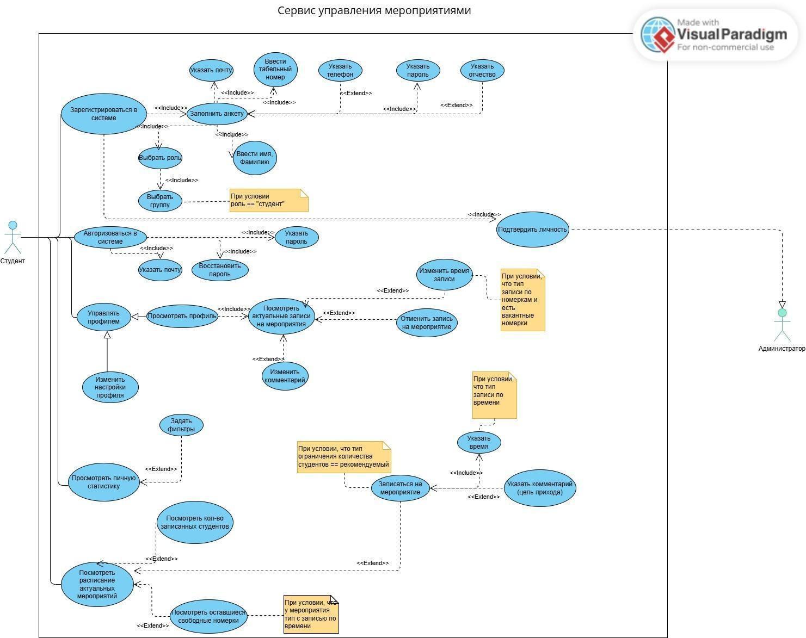
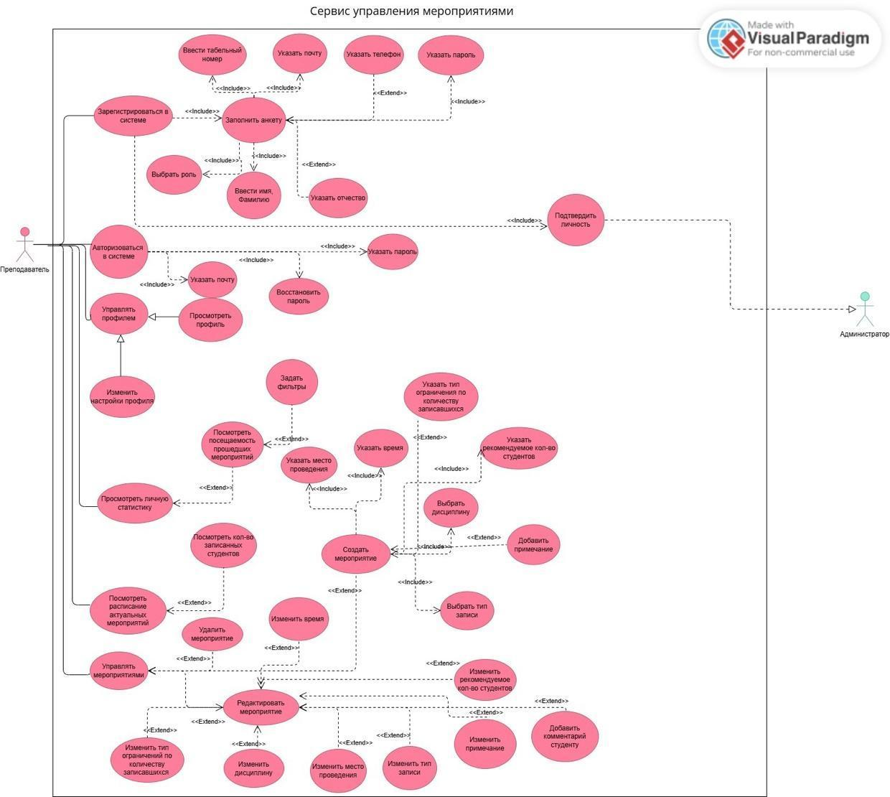
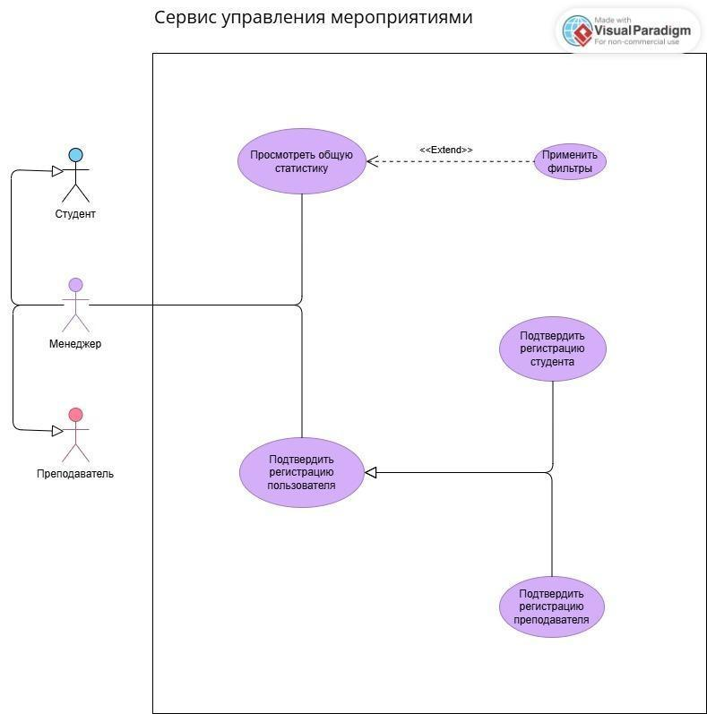
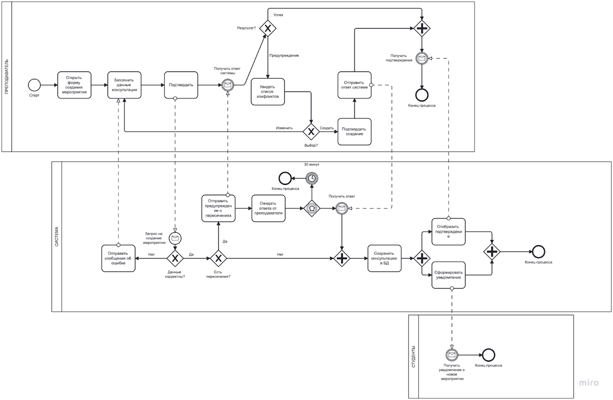
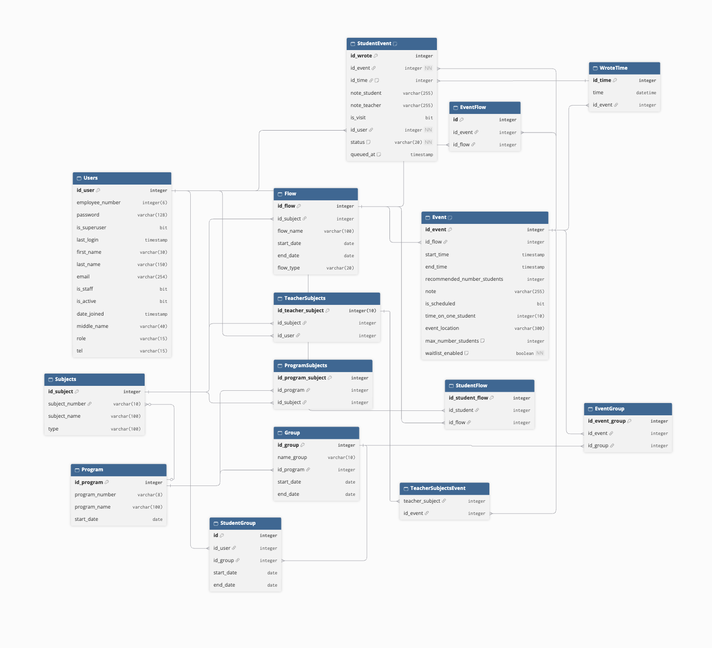
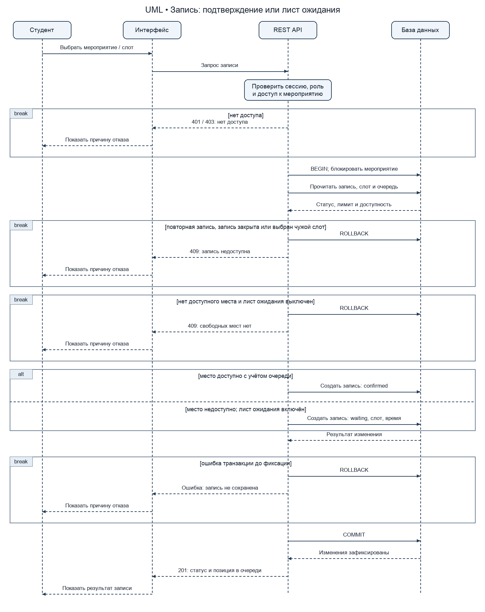
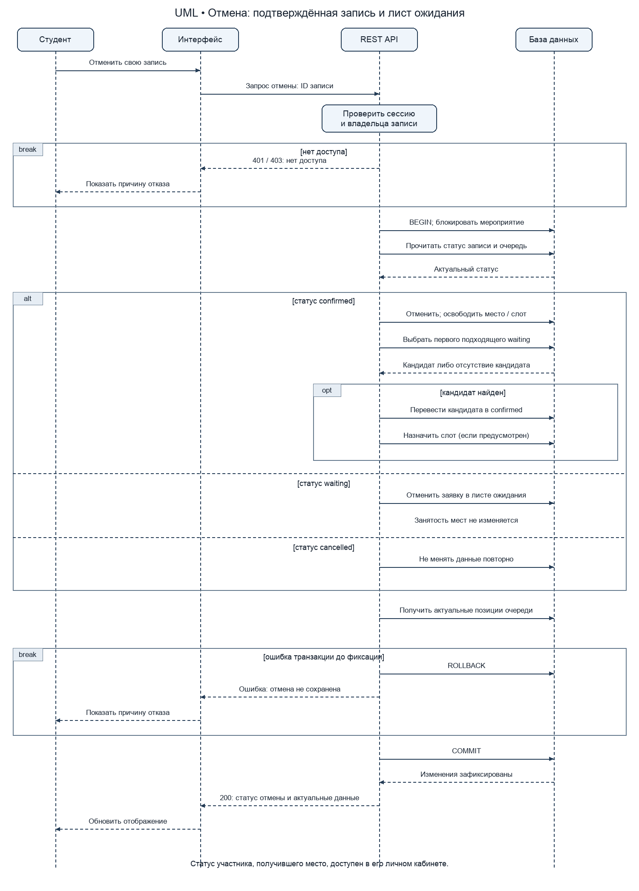
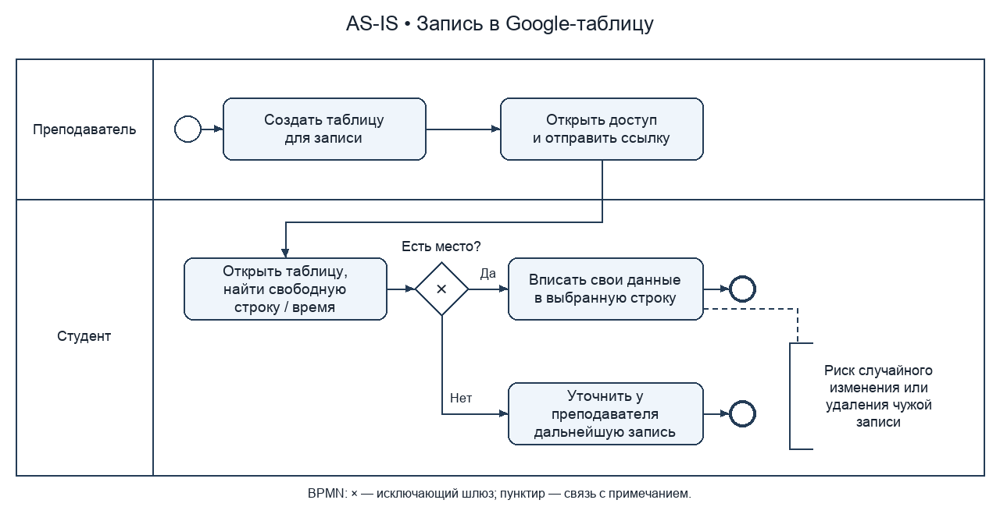
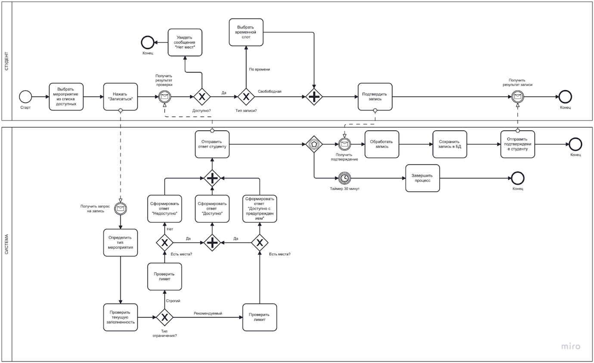

# ЛР 3 — проектирование

**Тема ВКР:** Разработка веб-сервиса по управлению учебными мероприятиями

**Участники команды:** Архангельская Елизавета Павловна, Данилова Анастасия Алексеевна

**Вклад каждого участника при командной работе:**

- **Архангельская Елизавета Павловна:** формулирование нефункциональных требований; подготовка ER-диаграммы, UML-диаграмм последовательностей записи и отмены и BPMN-диаграммы AS-IS; описание ограничений целостности данных и правил обработки очереди; обоснование перехода от AS-IS к TO-BE.
- **Данилова Анастасия Алексеевна:** описание предметной области и формулирование функциональных требований; подготовка трёх UML-диаграмм вариантов использования, BPMN-диаграммы создания консультации и BPMN-диаграммы TO-BE; обзор нотаций.

Согласование требований, выбор и обоснование нотаций, проверка связи моделей с требованиями и согласованности диаграмм, формулирование выводов и итоговое оформление отчёта выполнены совместно.

## 1. Предметная область и требования

### Описание предметной области

Веб-сервис предназначен для организации учебных мероприятий в университете, включая консультации, зачёты, экзамены и защиты работ. При записи через чаты, формы и общие таблицы сведения о мероприятиях, заявках и посещениях хранятся раздельно. При общем доступе на редактирование студент может случайно изменить чужую запись. Сведения об изменениях мероприятия и порядке участия приходится искать в таблице и сообщениях.

Сервис объединяет публикацию мероприятий, запись и отмену записи, выбор временных слотов, ведение очереди и учёт посещаемости. Студент просматривает доступные мероприятия по своим дисциплинам и отслеживает свои записи. Преподаватель управляет своими мероприятиями и отмечает посещаемость. Менеджер направления ведёт справочники и формирует сводные отчёты. Администратор управляет учётными записями и настройками сервиса. Связи мероприятий с дисциплинами, группами, потоками и образовательными программами позволяют отбирать данные для расписания и отчётности.

### Функциональные требования

| ID | Требование | Как проверить выполнение |
|---|---|---|
| FR-01 | Сервис позволяет пользователю войти в учётную запись и открыть функции, предусмотренные его ролью. | Войти под учётными записями студента, преподавателя и менеджера. Проверить, что каждой роли доступны её функции. |
| FR-02 | Студент может просматривать расписание доступных ему мероприятий, фильтровать его по дате, типу и дисциплине и открывать карточку мероприятия. | Создать мероприятия по двум дисциплинам. Проверить список доступных мероприятий, работу фильтров и отображение времени и места в карточке. |
| FR-03 | Преподаватель может создавать, редактировать и отменять свои мероприятия, указывая тип, дисциплину, время, место и лимит участников, если он предусмотрен. | Создать консультацию, перенести её на другое время и отменить. Проверить, что каждое изменение отражается в расписании. |
| FR-04 | Студент может записаться на мероприятие или выбрать свободный временной слот, если мероприятие предусматривает запись по слотам. Студент может отменить свою запись. | Записаться на свободный слот, проверить запись в личном кабинете, затем отменить её при пустом листе ожидания и убедиться, что слот снова доступен. |
| FR-05 | При отсутствии мест и включённом листе ожидания сервис добавляет студента в очередь и показывает позицию. После отмены подтверждённой записи место автоматически получает первый подходящий участник очереди. Отмена заявки из очереди не освобождает место. | Заполнить места и добавить две заявки в очередь. Отменить подтверждённую запись: проверить подтверждение первого кандидата и изменение позиции второго. Отдельно отменить ожидающую заявку: число занятых мест не должно измениться. |
| FR-06 | При создании или переносе мероприятия сервис предупреждает преподавателя о пересечении с другим его мероприятием. | Запланировать два мероприятия одного преподавателя на пересекающееся время и проверить появление предупреждения. |
| FR-07 | При переносе или отмене мероприятия сервис уведомляет записавшихся участников. | Записать студента на мероприятие, изменить его время и проверить уведомление. Повторить проверку при отмене. |
| FR-08 | Преподаватель может отметить фактическое присутствие или отсутствие студента в списке участников своего мероприятия. | Сохранить разные отметки для двух студентов и проверить их после повторного открытия списка. |
| FR-09 | Менеджер направления может формировать сводные отчёты по регистрациям и посещаемости с отбором по дисциплине, группе, потоку и образовательной программе. | Подготовить данные двух учебных групп, сформировать отчёт с фильтром по одной из групп и сверить итоги с её записями и отметками. |

### Нефункциональные требования

Нефункциональные требования фиксируют ограничения, вытекающие из ролевой модели, правил записи и разделения сервиса на клиентскую и серверную части.

| ID | Требование | Как проверить выполнение |
|---|---|---|
| NFR-01 | Сервер проверяет полномочия пользователя при выполнении защищённых операций, в том числе при запросах напрямую к API. | Отправить от имени студента запрос на редактирование мероприятия и от имени преподавателя запрос на изменение чужого мероприятия. Проверить отказ и отсутствие изменений. |
| NFR-02 | Сервис сохраняет целостность регистраций при одновременных запросах. У студента может быть только одна активная запись на мероприятие, а число подтверждённых записей не может превышать установленный строгий лимит. | Отправить параллельные запросы на последнее место и повторные запросы от одного студента. Проверить количество подтверждённых записей, в том числе для слота на одного участника. |
| NFR-03 | Изменение регистрации и связанных с ней данных о занятости слота и очереди выполняется как единая операция. При сбое частичные изменения не сохраняются. | В тестовой среде вызвать сбой во время отмены записи и проверить, что состояние регистрации, слота и очереди осталось согласованным. |
| NFR-04 | Клиентское приложение обменивается данными с сервером через документированный REST API. Документация описывает форматы запросов, ответов и ошибок. | По документации выполнить успешную запись и запрос на занятый слот. Сверить поля ответов и коды ошибок с описанием API. |

## 2. Обзор нотаций и видов диаграмм

| Нотация или вид диаграммы | Что описывает | Сильные стороны |
|---|---|---|
| BPMN | Ход бизнес-процесса: действия участников, события, развилки и обмен сообщениями. | Позволяет сопоставить текущий и целевой процессы записи на консультацию и показать, какие ручные действия возьмёт на себя сервис. |
| ER-диаграмма | Сущности предметной области, их атрибуты и связи, включая кратность связей. | Помогает спроектировать структуру базы данных и проверить, как связаны учебные мероприятия, временные слоты, записи студентов и отметки о посещении. |
| DFD — диаграмма потоков данных | Движение данных между внешними участниками, процессами и хранилищами. | Помогает проследить, откуда поступают данные о регистрации, где они сохраняются и как используются для формирования отчётов. |
| UML — диаграмма вариантов использования | Взаимодействие внешних ролей с системой и цели, которые они достигают с её помощью. | Показывает границы системы и позволяет проверить, предусмотрены ли сценарии для студента, преподавателя и менеджера направления. |
| UML — диаграмма последовательностей | Порядок обмена сообщениями между участниками сценария и компонентами системы. | Показывает, в каком порядке интерфейс, API и база данных обрабатывают запись, в том числе что происходит, если выбранный слот уже занят. |
| UML — диаграмма состояний | Состояния объекта и переходы между ними под действием событий и условий. | Позволяет проверить допустимые изменения статуса регистрации, например переход из подтверждённой записи в отменённую. |
| UML — диаграмма компонентов | Программные компоненты, их интерфейсы и зависимости. | Помогает определить границы ответственности клиентской и серверной частей и показать, через какой интерфейс они взаимодействуют. |
| UML — диаграмма развёртывания | Узлы среды выполнения, размещённые на них программные артефакты и связи между узлами. | Позволяет спланировать размещение приложения и базы данных, обозначить сетевые соединения и точки входа в сервис. |

## 3. Выбор нотаций для проекта

Для проектирования выбраны четыре вида диаграмм. BPMN описывает процессы, диаграммы вариантов использования — действия пользователей, а ER-модель — структуру данных. Диаграмма последовательностей дополняет их описанием обмена данными между интерфейсом, API и базой данных.

| Нотация или вид диаграммы | Что моделируем | Связанные требования | Почему подходит |
|---|---|---|---|
| BPMN | Создание консультации с проверкой пересечений, предварительную проверку доступности и запись. Сопоставляем запись в Google-таблицу (AS-IS) и через сервис (TO-BE). | FR-03, FR-04, FR-06 — показанные части сценариев | Показывает действия участников и проверки системы. Отмена, очередь и транзакции раскрываются отдельно на диаграммах последовательностей. |
| UML — диаграмма вариантов использования | Вход, расписание, запись и отмену, управление мероприятиями и просмотр статистики. | FR-01–FR-04, FR-09 — основные действия; NFR-01 — разделение ролей | Определяет основные цели пользователей и доступные действия каждой роли. |
| ER-диаграмма | Мероприятия, слоты, регистрации и их статусы, очередь, отметку посещения и учебные справочники. | FR-02, FR-04, FR-05, FR-08, FR-09; NFR-02 | Показывает данные для записи, очереди и отчётов. Строгий лимит задан в Event, статус и время постановки в очередь — в StudentEvent. Условия уникальности описаны в пояснении к модели. |
| UML — диаграмма последовательностей | Запись и отмену через API, отказы, переход из очереди в подтверждённую запись и границы транзакции. | FR-04, FR-05, NFR-01–NFR-03; NFR-04 — примеры обмена через API | Разделяет успешные и ошибочные сценарии, подтверждённые и ожидающие записи. Показывает порядок обмена запросами и ответами между компонентами. |

## 4. Модели системы

### UML — диаграммы вариантов использования

Диаграммы вариантов использования показывают доступные действия студента, преподавателя и менеджера направления.

Рисунок 1 — Диаграмма вариантов использования для студента

Рисунок 2 — Диаграмма вариантов использования для преподавателя

Рисунок 3 — Диаграмма вариантов использования для менеджера направления

Модели охватывают вход, просмотр расписания, управление мероприятиями, запись и отмену, а также просмотр статистики (FR-01–FR-04, FR-09). Разделение действий по ролям задаёт основу для проверки полномочий на сервере (NFR-01).

### BPMN — создание консультации и запись на мероприятие

На рисунке 4 показано создание консультации с проверкой пересечений (FR-03 и часть FR-06). Запись студента на мероприятие показана на рисунке 9 (FR-04). На рисунке 4 также показана отправка уведомления о новом мероприятии.

Рисунок 4 — BPMN-диаграмма создания консультации преподавателем

### ER-диаграмма — модель данных

Рисунок 5 — ER-диаграмма сервиса управления учебными мероприятиями

ER-модель показывает структуру данных для учебных мероприятий, времени записи и участия студентов (FR-02, FR-04). Поле `StudentEvent.is_visit` хранит отметку посещения (FR-08), а связи с группами, потоками, дисциплинами и программами дают основу для отчётности (FR-09).

Позиция в очереди вычисляется по времени постановки и идентификатору записи. Активными считаются статусы `confirmed` и `waiting`; для пары «студент — мероприятие» допускается только одна активная запись. Запись в очереди не занимает место. Для модели заданы ограничения допустимых статусов, обязательного времени постановки для ожидающих заявок, уникальности активной записи и единственной подтверждённой записи на слот. Проверка лимита и изменение статусов выполняются в транзакции с блокировкой мероприятия (NFR-02, NFR-03).

### UML — диаграммы последовательностей

Диаграммы уточняют проектируемое взаимодействие студента, интерфейса, REST API и базы данных при записи и отмене (FR-04, FR-05, NFR-01–NFR-04).

Рисунок 6 — UML-диаграмма последовательности записи на мероприятие

Сервер проверяет полномочия пользователя и доступ к мероприятию. Все операции записи и отмены сначала блокируют мероприятие в одной транзакции, затем проверяют актуальные данные о регистрации, слотах, лимите и очереди. Общая блокировка нужна и для записи по слотам, чтобы согласованно проверять лимит всего мероприятия. Уникальность активной записи дополнительно обеспечивается ограничением базы данных.

Фрагмент `break` завершает сценарий после отказа: последующие создание записи и `COMMIT` не выполняются. Если транзакция уже начата, перед отказом выполняется `ROLLBACK`. Взаимоисключающие ветви `alt` создают либо подтверждённую запись, либо заявку в очередь. Ошибка операции базы данных до фиксации ведёт к откату; ветка ошибки на схеме обобщает этот обработчик. Успешный ответ отправляется только после подтверждения `COMMIT`. Коды ответов являются проектным предложением для API.

Рисунок 7 — UML-диаграмма последовательности отмены записи

Сервер проверяет владельца записи и повторно читает её статус после блокировки мероприятия. Для `confirmed` он освобождает место и автоматически подтверждает первого подходящего участника листа ожидания. Для `waiting` отменяется только заявка, без изменения занятости. Для `cancelled` данные повторно не меняются. Все изменения фиксируются вместе; при сбое откатываются.

**Правила листа ожидания.** Порядок определяется временем постановки в очередь, при совпадении времени — идентификатором записи. Для мероприятия со слотами студент ожидает выбранный слот: при его освобождении рассматриваются только заявки на этот слот. Для мероприятия без слотов рассматривается общая очередь. Кандидат должен иметь статус `waiting` и сохранять право участия. Если подходящего кандидата нет, место остаётся свободным. Новая заявка не должна обходить более раннюю подходящую заявку; позиция вычисляется среди действующих подходящих заявок. Изменённый статус доступен участнику в личном кабинете.

### Связь требований с представленными моделями

| Требования | Представление в моделях и описании |
|---|---|
| FR-01, FR-02 | Рисунки 1–3: вход, расписание и фильтры; рисунок 5: связанные данные. Состав фильтров и карточки мероприятия определён в требованиях. |
| FR-03, FR-06 | Рисунок 2: управление мероприятием; рисунок 4: создание консультации и проверка пересечений. |
| FR-04, FR-05 | Рисунки 6–7: запись, очередь, отмена и автоматическое занятие освободившегося места; рисунок 9: основной процесс записи. Правила выбора участника из очереди описаны выше. |
| FR-07 | Условия отправки уведомлений при переносе и отмене определены в функциональных требованиях раздела 1. |
| FR-08, FR-09 | Рисунки 2–3: просмотр посещаемости и статистики; рисунок 5: хранение отметки посещения и связи с учебными справочниками. Действия с отметками и разрезы отчётности определены в требованиях. |
| NFR-01–NFR-03 | Рисунки 6–7: проверка доступа, общая блокировка, отказы, фиксация и откат. Ограничения уникальности описаны в пояснении к модели данных. |
| NFR-04 | Рисунки 6–7: обмен запросами и ответами REST API в сценариях записи и отмены. |

Модели сосредоточены на ключевых процессах создания мероприятия, записи, работы очереди и отмены. Диаграммы и текстовые требования дополняют друг друга: схемы раскрывают структуру и взаимодействия, а требования задают условия выполнения пользовательских действий.

## 5. AS-IS и TO-BE

**Выбранная нотация:** BPMN

### AS-IS — текущее состояние

Рисунок 8 — BPMN-диаграмма текущего процесса записи в Google-таблицу (AS-IS)

Сейчас в ИТМО почти все преподаватели, с которыми мы взаимодействовали в ходе обучения, используют Google-таблицы для записи на учебные мероприятия. Преподаватель создаёт таблицу, открывает студентам доступ на редактирование и отправляет ссылку. Студент находит свободную строку или указанное в таблице время и самостоятельно вписывает свои данные. Если свободных мест нет, дальнейшую запись приходится уточнять у преподавателя.

При совместном редактировании студент может случайно изменить или удалить чужую запись либо вписать себя в строку, которую одновременно выбрал другой студент. Если чужая запись была перезаписана, её можно восстановить по истории изменений ячейки, однако это требует дополнительных действий и неудобно для участников. Положение строки не гарантирует актуальное место в очереди, поскольку строки можно перемещать и сортировать. Выбор времени возможен, если преподаватель заранее разметил слоты, но занятость слота и пересечения с другими мероприятиями требуют отдельной проверки. Отмена записи и продвижение очереди также обрабатываются вручную. Хранить в общей таблице служебные сведения преподавателя неудобно: для них требуется отдельный документ с ограниченным доступом.

### TO-BE — предлагаемое состояние

Рисунок 9 — BPMN-диаграмма записи студента на мероприятие через веб-сервис (TO-BE)

Диаграмма показывает целевой сценарий, в котором студент выбирает мероприятие и записывается через веб-сервис (FR-04).

На схеме система определяет тип мероприятия, проверяет заполненность и лимит, возвращает результат проверки, а после подтверждения сохраняет запись в базе данных. Для записи по времени студент выбирает слот. Схема показывает основные этапы процесса; проверки повторных запросов, работа листа ожидания и транзакции раскрыты на новых диаграммах последовательностей в разделе 4. Для строгого лимита окончательная проверка доступности выполняется при сохранении, поскольку после предварительной проверки свободное место может занять другой студент.

### Обоснование перехода

Переход к веб-сервису заменяет свободное редактирование общей таблицы отдельными операциями записи и отмены с серверной проверкой прав и доступности места. Преподаватель задаёт условия мероприятия заранее, а студент получает результат обработки непосредственно в интерфейсе.

| AS-IS | Решение в TO-BE и отражение на моделях | Связанные требования |
|---|---|---|
| Студент выбирает свободную строку или время в таблице; занятость и конфликты проверяются вручную. | На BPMN TO-BE система проверяет заполненность и лимит, а студент выбирает временной слот. UML уточняет повторную проверку внутри транзакции перед сохранением. | FR-04, NFR-02 |
| Есть риск повторной записи и случайной перезаписи данных другого студента. | На UML сервер проверяет наличие активной записи и права пользователя. Ограничение уникальности предотвращает повторы, а проверка владельца запрещает изменение чужой записи. | NFR-01, NFR-02 |
| Запись представлена редактируемой строкой таблицы; отдельного статуса регистрации нет. | На BPMN TO-BE система сохраняет запись и отправляет подтверждение; UML показывает возврат статуса в интерфейс после фиксации изменений. | FR-04, NFR-04 |
| При отсутствии мест и отменах очередь приходится вести вручную. | UML показывает создание записи в листе ожидания и согласованное обновление очереди при отмене. Студент получает свой статус и позицию без доступа к общей таблице. | FR-05, NFR-01, NFR-03 |

Ожидаемый результат — снижение риска случайного изменения чужих записей и единое актуальное состояние регистраций, доступное пользователям в пределах их полномочий. Сокращение времени обработки является ожидаемым эффектом; количественно его можно оценить после реализации на одинаковых сценариях записи и отмены. Для перехода необходимо настроить роли, перенести сведения о мероприятиях и действующих записях, проверить ограничения целостности и проверить правила работы листа ожидания.

## 6. Выводы

В ходе работы описана предметная область веб-сервиса управления учебными мероприятиями, сформулированы функциональные и нефункциональные требования и выбраны четыре вида диаграмм: BPMN, UML-диаграммы вариантов использования и последовательностей, а также ER-диаграмма. Их сочетание позволяет рассмотреть проект на уровне действий пользователей, организации процессов, хранения данных и взаимодействия компонентов.

Диаграммы вариантов использования определяют действия студента, преподавателя и менеджера направления. BPMN показывает порядок создания консультации и записи на мероприятие, а ER-модель задаёт основу хранения связанных данных. Диаграммы последовательностей уточняют обработку записи и отмены на сервере: проверку полномочий, доступности места и повторных запросов, изменение очереди и фиксацию результатов в одной транзакции. Для записи и отмены пользовательские сценарии связаны с операциями над данными и требованиями к их целостности.

Сравнение AS-IS и TO-BE показало, какие действия при записи через Google-таблицы можно автоматизировать. В предлагаемом сервисе проверка доступности места, сохранение регистрации и обновление очереди выполняются по единым правилам. Разграничение прав ограничивает изменение чужих записей, а транзакционная обработка и ограничения базы данных должны предотвращать повторные регистрации и превышение строгого лимита при одновременных запросах. Студент получает статус своей записи и позицию в очереди, а изменение чужих записей ограничено правами доступа.
